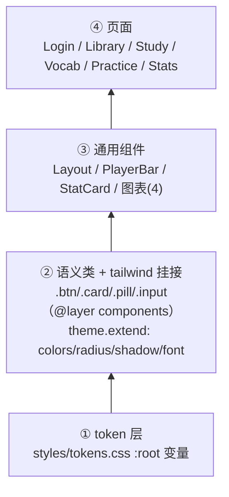
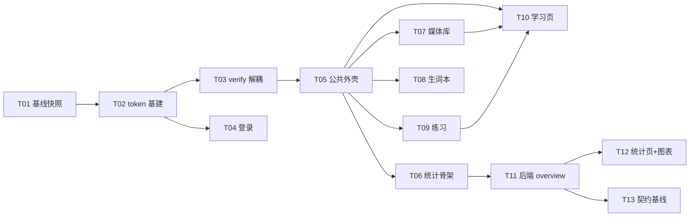

# ARCH · FayeLong UI 落地 v1（增量架构 + 任务分解）

> 版本 v1 · 2026-10-22 · 架构：高见远
> 需求基线：`docs/PRD-UI-落地-v1.md`（20 条：P0 6 / P1 7 / P2 7）
> 技术依据：`design/UI-落地执行计划.md`（数据矩阵 §4、统计端点 §4.3、统计页 §5）、`design/design-contract.md`（token 契约）
> 基线版本：v1.16.1 / `7e53f45`
>
> **本文只做「落地方案 + 任务分解」，不新增任何 PRD 范围外的业务功能。** P3（SRS 字段 / 练习落库 / 学习时长埋点）明确不做。

---

## 1. 方案总览

**一句话**：在现有 `frontend-vue` 上叠一层「CSS 变量 token + 少量语义类」作为视觉底座，在不动任何 `data-*` 与业务逻辑的前提下逐页换皮，最后补一个只读聚合端点 `/api/stats/overview` 与统计页，全程以 7 个 verify + 数据指纹作门禁。

**分层（自下而上，单向依赖）**



**为什么选「CSS 变量 + 少量工具类」，而不是重写 tailwind theme 或引组件库**

| 备选 | 否决理由 |
|---|---|
| 全量重写 `tailwind.config` theme（覆盖默认 slate/emerald…） | 会改掉现有页面里所有 `bg-slate-*` 的语义 → 等于一次性重排 6 页，风险与「逐页可回滚」要求冲突；且 verify 脚本大量依赖现有类名/结构 |
| 引入组件库（Element/Vuetify 等） | PRD 明确 Out of scope；体积大；样式覆盖成本 > 手写 6 页；图表库同理（契约 §10 v3 要求 SVG 自绘） |
| **CSS 变量 + `theme.extend` 只挂高频键 + 语义类**（选中） | ① 色板/圆角/阴影/字体单一真相在 `:root`，改色只改一处；② 页面可渐进式换皮、逐页提交、逐页回滚；③ 保留全部现有 tailwind 能力，不破坏既有类名；④ 零新增依赖 |

设计铁律：**token 层是唯一写十六进制色值的地方**（SVG 图标用 `currentColor` 继承，属契约允许的例外）。

---

## 2. token 落地设计

### 2.1 文件与内容清单

**新建 `frontend-vue/src/styles/tokens.css`**，由 `src/index.css` 顶部 `@import`（`@import` 必须在 `@tailwind` 之前）。

变量**逐字对齐契约**（PRD P0-1 验收要求 `grep` 到 `--lemon-400: #FFD93B` 且与契约 §1–§3 一致，故**不加前缀**）：

| 分组 | 变量（与契约 §1 逐字一致） |
|---|---|
| 主色 | `--lemon-400:#FFD93B` `--lemon-300:#FFE566` `--lemon-500:#EFC01A` `--lemon-200:#FFEFB4` `--lemon-100:#FFF8DE` |
| 墨/文字 | `--ink:#4A2B14` `--ink-2:#6E4E35` `--ink-3:#8A6A50` |
| 叶绿 | `--leaf:#9FBE33` `--leaf-1:#E2EDB4` |
| 桃红 | `--peach:#F79E93` `--peach-1:#FFE0DA` |
| 面 | `--cream:#FFFBF0` `--cream-2:#FFF4DC` `--card:#FFFFFF` |

**额外新增（契约 §3 形状/字体/间距，用 `--fl-` 前缀避免与色板语义混淆）**：

| 用途 | 变量 | 值 |
|---|---|---|
| 描边 | `--fl-stroke` | `2px` |
| 圆角（3 档） | `--radius-card` `--radius-control` `--radius-pill` | `20px` `14px` `999px` |
| 硬阴影（贴纸） | `--shadow-sticker` `--shadow-sticker-lift` | `0 3px 0 var(--ink)` `0 5px 0 var(--ink)` |
| 焦点光环 | `--fl-ring` | `0 0 0 4px rgba(255,217,59,.5)` |
| 字体栈 | `--font-sans` | `-apple-system, "PingFang SC", "Microsoft YaHei", "Noto Sans SC", system-ui, sans-serif` |
| 间距基数 4（实取） | `--fl-space-8/12/14/18/22/26/34` | 同名 px |
| 点阵纹理 | `--fl-dots` | `radial-gradient(var(--cream-2) 1px, transparent 1px)` |

> **命名冲突裁决**：团队侧曾提议 `--fl-lemon-400`。但 PRD P0-1 验收条款要求变量名与契约「逐字一致」且能 `grep` 到 `--lemon-400: #FFD93B`，故**色板 15 个变量严格用契约名（无前缀）**，我新增的非契约 token 才用 `--fl-` 前缀。以 PRD 为准。

### 2.2 tailwind `theme.extend` 挂接（只挂高频，不全量映射）

`frontend-vue/tailwind.config.js`：

| 键 | 映射（值全部指向 CSS 变量，token 单一真相） |
|---|---|
| `colors.lemon` | `{100:'var(--lemon-100)',200:…,300:…,400:…,500:…}` |
| `colors.ink` | `{DEFAULT:'var(--ink)',2:'var(--ink-2)',3:'var(--ink-3)'}` → `text-ink` / `text-ink-2` |
| `colors.leaf` | `{DEFAULT:'var(--leaf)',1:'var(--leaf-1)'}` |
| `colors.peach` | `{DEFAULT:'var(--peach)',1:'var(--peach-1)'}` |
| `colors.cream` | `{DEFAULT:'var(--cream)',2:'var(--cream-2)'}` |
| `colors.card` | `'var(--card)'` |
| `borderRadius` | `{card:'var(--radius-card)',control:'var(--radius-control)',pill:'var(--radius-pill)'}` |
| `boxShadow` | `{sticker:'var(--shadow-sticker)', 'sticker-lift':'var(--shadow-sticker-lift)'}` |
| `fontFamily` | `{sans:['var(--font-sans)']}` |

**注意**：用 `var()` 挂接的颜色**不支持 `/opacity` 修饰符**（如 `bg-lemon-400/50`）。需要半透明时用独立变量（如 `--fl-ring`）或 `color-mix()`，不硬编码色值。

### 2.3 通用类基座（P0-3）

放进 `src/index.css` 的 `@layer components`（PRD P0-3 允许「components.css **或** index.css @layer components」；选后者避免 `@import` 顺序问题）。类清单：`.btn` `.btn-primary` `.btn-secondary` `.btn[disabled]` `.card` `.pill` `.bar` `.chip` `.input` `.nav-pill`。**只加类，不动任何页面**（本阶段 `git diff --stat` 中 `src/pages/**`、`src/components/**` 必须为 0）。

### 2.4 画布底（P0-4）

`src/index.css` 的 `body`：`background:var(--cream)` + `18px` 点阵（`background-image:var(--fl-dots); background-size:18px 18px;`）+ `color:var(--ink)` + `font-family:var(--font-sans)`。**无 http(s) 外链资源**。

### 2.5 `index.css` 结构（改后）

```css
@import './styles/tokens.css';
@tailwind base;
@tailwind components;
@tailwind utilities;

@layer base { html,body,#root{height:100%} body{ /* cream + dots + ink + font-sans */ } }
@layer components { /* .btn .card .pill .bar .chip .input .nav-pill */ }
```

---

## 3. verify 断言解耦方案（P0-5 · 最高优先级）

> **PRD/派单只点了 2 个脚本，实测有 7 个脚本存在「视觉类名 / 导航条数」耦合**。只修 2 个会导致 P1-1 登录、P1-2 外壳、P1-6 练习必红。下表是全量清单（已逐个 `grep` 取证）。

### 3.1 全量耦合清单（文件:行 → 原断言 → 新断言）

| # | 文件:行 | 原断言（视觉/条数耦合） | 新断言（语义锚点 + 向后兼容 fallback） | 替代属性 |
|---|---|---|---|---|
| 1 | `verify_m5.mjs:385` | `className.includes('bg-slate-900')` 判宫格 active | `data-state==='active'`（fallback: 原类名） | 宫格按钮 `data-state` |
| 2 | `verify_m5.mjs:386` | `bg-emerald-100` 判 mastered | `data-state==='mastered'`（fallback） | 同上 |
| 3 | `verify_m5.mjs:387` | `bg-amber-100` 判 attempted | `data-state==='attempted'`（fallback） | 同上 |
| 4 | `verify_m5.mjs:388` | `bg-slate-100` 判 fresh | `data-state==='fresh'`（fallback） | 同上 |
| 5 | `verify_m5.mjs:427` | `card.className.includes('ring-2')` | `card.dataset.highlight==='true'`（fallback: `ring-2`） | 舞台卡 `data-highlight` |
| 6 | `verify_m5.mjs:273` | `/sky/.test(b2.className)` 判 A-B 激活 | `b2.dataset.state==='ab-active'`（fallback: `sky`） | A-B 按钮 `data-state` |
| 7 | `verify_vue_skeleton.mjs:223` | `classList.contains('bg-slate-900')` | `a.dataset.active==='true'`（fallback: 原类名） | 导航链接 `data-active` |
| 8 | `verify_vue_skeleton.mjs:227` | `navHome.length === 2 && [0]==媒体库…` | **按文本定位**：存在文本「媒体库」的链接且 `active` 为真、其余项非 active；**不做条数硬校验** | 同 #7 |
| 9 | `verify_vue_skeleton.mjs:268` | `/vocab` 高亮读 `bg-slate-900` | `a.dataset.active==='true'`，按文本「生词本」定位 | 同 #7 |
| 10 | `verify_vocab_practice.mjs:433` | `modeBtn.className.includes('bg-slate-900')` | `modeBtn.dataset.selected==='true'`（fallback） | 模式按钮 `data-selected` |
| 11 | `verify_vocab_practice.mjs:508` | 同上（听写模式） | 同上 | 同上 |
| 12 | `verify_vocab_practice.mjs:465` | `/emerald/.test(marked.className)` 判选项正确高亮 | `marked.dataset.tone==='correct'`（fallback: `emerald`） | 选项 `data-tone` |
| 13 | `verify_vue_login.mjs:279` | `navLinks.length === 2` | `navLinks.length >= 2`（登录成功只证明「进入 Layout」，条数非业务语义） | — |
| 14 | `verify_vue_login.mjs:308` | `navLinks.length === 2` | `>= 2` | — |
| 15 | `verify_vue_roundB.mjs:185` | `navLinks.length === 2` | `>= 2` | — |
| 16 | `verify_v1_12.mjs:174` | `b.className.includes('rounded-md')` 找宫格按 | `b.hasAttribute('data-grid-cell')`（fallback: `rounded-md`） | 宫格 `data-grid-cell` |
| 17 | `verify_category.mjs:221` | `(className||'').includes('font-medium')` 找选中分类 | `el.dataset.selected==='true'`（fallback: `font-medium`） | 分类项 `data-selected` |

**分组**：
- **必修（落在 7 verify + 各页 DoD 内）**：#1–#14（m5 / skeleton / vocab_practice / vue_login）
- **建议同批修（避免遗留红）**：#15–#17（roundB / v1_12 / category）

> **不可动的业务断言（明令禁止弱化/删除）**：`verify_m5` 的 A-B 三段 title 文本（`设定 A 点`/`在当前位置设定 B 点`/`清除 A-B 循环`）、笔记面板 5 项、听写历史条数；`verify_vue_skeleton` 的三段式 flex/overflow、`h-dvh` 高度、四路由 `main h2` 文案、375px 无横向滚动；`verify_vocab_practice` 的 `data-practice-*` 全部 15 个；`verify_m4` 的 `[data-vocab-row]`；`verify_marks` / `verify_attempt_history` 的 `data-testid` 全家桶。**本次只碰「颜色类名」与「导航条数」两类断言。**

### 3.2 被断言元素需补的 `data-*` 取值表（在各自 P1 换皮任务里落，不在 P0 落）

| 元素 | 所在文件 | 新增属性 | 取值 | 落地任务 |
|---|---|---|---|---|
| 句子宫格按钮 | `pages/StudyPage.vue` | `data-state` | `active` / `mastered` / `attempted` / `fresh` | P1-7 |
| 句子宫格按钮 | `pages/StudyPage.vue` | `data-grid-cell`（无值） | — | P1-7 |
| 句子舞台卡 | `components/SentenceStage.vue` | `data-highlight` | `true` / `false` | P1-7 |
| A-B 按钮 | `components/SentenceStage.vue` | `data-state` | `ab-idle` / `ab-a` / `ab-active` | P1-7 |
| 顶栏导航链接 | `components/Layout.vue` | `data-active` | `true` / `false` | P1-2 |
| 练习模式按钮 | `pages/VocabPracticePage.vue` | `data-selected` | `true` / `false` | P1-6 |
| 练习选项 | `pages/VocabPracticePage.vue` | `data-tone` | `correct` / `wrong` / `neutral` | P1-6 |
| 分类项 | `pages/MediaLibraryPage.vue`（CategoryChips） | `data-selected` | `true` / `false` | P1-4 |

### 3.3 「先绿后换皮」的执行策略（把 PRD 的验收条款兑现）

PRD P0-5 要求「**改完脚本、未改页面源码前提下仍全绿**」。因此脚本改造必须**自带 className fallback**：

```js
const stateOf = (el) =>
  el.dataset.state ||
  (el.className.includes('bg-slate-900') ? 'active'
   : el.className.includes('bg-emerald-100') ? 'mastered'
   : el.className.includes('bg-amber-100') ? 'attempted'
   : el.className.includes('bg-slate-100') ? 'fresh' : '');
```

- **P0-2（脚本改造）**：断言优先读 `data-*`，缺失则回落原类名 → 页面零改动，脚本仍绿（证明解耦未引入回归）。
- **P1-7 / P1-6 / P1-2（换皮）**：给元素补 `data-*`，此时 `data-*` 生效，fallback 自然失效。
- **各页换皮提交内**：顺手删掉该页对应的 fallback 分支（可选，建议留着作为「防漏加属性」的兜底，不影响正确性）。

---

## 4. 公共外壳改造（P1-2）

### 4.1 导航（4 项，实链）

| 文本 | 路由 | 高亮判定 |
|---|---|---|
| 媒体库 | `/` | `path === '/'` |
| 生词本 | `/vocab` | `path === '/vocab'`（**精确**，避免 `/vocab/practice` 同时点亮） |
| 练习 | `/vocab/practice` | `path === '/vocab/practice'` |
| 统计 | `/stats` | `path === '/stats'` 或前缀 |

**关键**：现有 `isVocabActive()` 用 `startsWith('/vocab/')`，加「练习」后会让 `/vocab/practice` 同时点亮两个 → 必须改为精确匹配 `/vocab`，练习单独判定。判定顺序：先 practice，再 vocab。

### 4.2 结构（保留三段式，Tab Bar 成为真正的 `<footer>`）

```
.h-dvh.flex.flex-col.overflow-hidden
├─ <header>            shrink-0   （品牌 + 4 导航药丸 + BackendStatus + AccountMenu）
├─ <main>              flex-1 min-h-0 overflow-y-auto
├─ <PlayerBar/>        shrink-0（仅 current 时渲染，普通 flex 子项）
└─ <footer> Tab Bar     shrink-0  （移动端 48px + 10.5px 文字 + env(safe-area-inset-bottom)）
```

**层叠处理（Q3 落地裁决）**：
- **Tab Bar 常驻**，是真正的第三段 `<footer>`（`shrink-0`）。桌面用 `md:hidden`（`display:none`，元素仍在 DOM，`getComputedStyle().flexShrink` 仍为 `0`）。
- **PlayerBar 保持普通 flex 子项，位置在 `<main>` 与 `<footer>` 之间**。视觉上它「叠在 Tab 之上」，但用 **flex 堆叠**而非 `fixed + bottom:tab-height`：`main` 是 `flex-1 min-h-0`，两个 `shrink-0` 底条不会裁切 `main` 可视区（满足 Q3「不因叠加而裁切」），且**零 z-index 冲突**。
- 理由：`fixed` 叠加会遮住学习页最后一行内容、且需魔法 `height` 补偿；flex 堆叠由布局引擎兜底，与现有外壳哲学一致。
- **`verify_vue_skeleton` 的 footer 三段式断言**：当前代码 PlayerBar 根节点是 `<div>` 而非 `<footer>`，推断「`footer.flexShrink==='0'`」这一项**当下可能为红**（详情见 §5.8 待核项）。P1-2 引入真实 `<footer>` 后**转绿**——属改善，不是回退。

### 4.3 `data-*` 保全清单（外壳）

| 项 | 要求 |
|---|---|
| `main h2` 文案 | 必须仍是含 `媒体库` / `学习页` / `生词本` / `生词练习` 的标题（skeleton 四路由断言） |
| 顶栏 `<a>` | 4 个导航项必须仍是 `<a>`（RouterLink 渲染），`verify_mobile` 量 `header a` 触摸目标 ≥32 |
| `PlayerBar` | `data-testid="player-bar"` 不动；根仍 `shrink-0`；进度条 `input[type=range]`、`select`（语速）保留（mobile 断言 3 项） |
| `h-dvh` | 外壳根类名保留（skeleton 用它定位），**禁止出现 `calc(100vh - …)`**（`grep` 零命中） |

导航链接加 `:data-active="active ? 'true':'false'"`（§3.2）。

---

## 5. 逐页改造策略（P1-1、P1-3…P1-7）

> 通用铁律：**只重排容器与样式，不删任何 `data-*` / `data-testid`，不改业务逻辑（fetch / 判分 / 播放 / 显隐）。** 每页改完先 `vite build`，再跑「该页对应 verify」，最后 390px 人工 checklist。

| 页 | 保留的 DOM 结构 | 允许重排的容器 | 必须保留的 data-* / testid | 对应 verify |
|---|---|---|---|---|
| **P1-1 登录** `LoginPage.vue`+`App.vue` | `form` 内用户名/密码/提交；`form button[type=submit]` 唯一 | 左右分栏（品牌面/表单面）、右上探头龙贴纸、底部「只存在本机」 | **placeholder 一字不改**（`当前密码`/`新密码…`/`例如 faye`）；按钮文案 `修改密码`/`保存`/`取消` 不变 | `verify_vue_login` |
| **P1-3 统计骨架** `StatsPage.vue`(新)+`router`+`Layout` | `main h2`「学习统计」；7 区块占位骨架 | 整页新写 | 顶栏「统计」高亮 `data-active` | `verify_vue_skeleton`（+ 新增 `/stats` 路由探测） |
| **P1-4 媒体库** `MediaLibraryPage.vue`(853)+`MediaRow`+`CategoryChips`+`StatCard`+`ListSkeleton` | 上传/分类/排序/搜索交互 DOM；`a[title="进入学习页"]`；骨架屏 `ListSkeleton` | Hero/数据条/继续学习卡/筛选 chip/课程网格/上传区 六区重排；移动端卡片→横排列表行 | `data-testid="toggle-note"`；`[data-vocab-row]`（在本页演练入口之后）；概览四项文案 `素材*/句子/生词/句子笔记` | `verify_vue_skeleton` + `verify_m4` |
| **P1-5 生词本** `VocabPage.vue`+`VocabRow`+`category.ts` | 筛选逻辑；`data-vocab-row` 行容器 | 列表/筛选/空态重排；**状态标签只两态**（已掌握/未掌握） | `data-vocab-row`（筛选断言锚点）；VerRow 内「笔记」入口文案须以 `笔记` 开头 | `verify_m5` |
| **P1-6 练习** `VocabPracticePage.vue`(708)+3 子组件+`question-types/**` | 判分逻辑（纯前端本地判分，**零改动**）；阶段机 setup/quiz/result | 对/错/漏高亮、会话统计重排 | **15 个 `data-practice-*` 全保留**（phase/rate/hint/accuracy/retry-wrong/progress/badge/play/play-slow/plays/prompt/speak/input/submit/option/feedback/next）；补 `data-selected`（模式）、`data-tone`（选项） | `verify_vocab_practice` |
| **P1-7 学习页** `StudyPage.vue`(765)+`SentenceStage.vue`(609)+`ClickableText`+`PlayerBar` | 见下方专项；`#root`→`h-full` 三段式 | 舞台 / 右侧句子列表 / 播放条布局重排 | 15 个 testid 全保留（见 §5.1.2）；补 `data-state`/`data-grid-cell`/`data-highlight`/A-B `data-state` | `verify_mobile`+`verify_m5`+`verify_marks`+`verify_attempt_history` |

### 5.1 学习页专项（最高风险，单独硬约束）

#### 5.1.1 布局铁律
- 外壳由 Layout 的 `h-dvh` 三段式提供，`StudyPage` 根只写 `h-full`；**严禁 `calc(100vh - Npx)`**（`grep -rn "calc(100vh" src` 必须零命中）。
- 三段：顶部信息条（已听写/已掌握/平均最佳，保持横排不压成竖排单字 `verify_mobile`）→ 舞台区 `flex-1 min-h-0 overflow-y-auto` → 底部「上一句 / 下一句 / 宫格」。移动端触摸目标 ≥32（宫格 h-8）／关键按钮 ≥44。
- 播放条：`data-testid="player-bar"`、进度条宽 ≥40、`select` 语速、不横向溢出（`verify_mobile` 3 项）。

#### 5.1.2 `data-*` 保全（一个都不能少）
`sentence-stage-card`、`sentence-stage`、`sentence-text`、`sentence-zh`、`toggle-mark`、`toggle-note`、`toggle-correct`、`mark-hint`、`sentence-grid`、`dictation-input`、`dictation-meta`、`dictation-error-words`、`dictation-history-item-*`、`dictation-history-input-*`、`open-player`、`player-bar`。

#### 5.1.3 交互零改动
- **A-B 循环 title 三段文本**逐字保留：`设定 A 点（开始片段循环）` / `在当前位置设定 B 点` / `清除 A-B 循环`（`verify_m5` 靠 title 定位）。
- 键盘翻句/输入框不劫持（B9）、草稿跨页（B10）、宫格着色三分、笔记面板、听写历史趋势条：逻辑零改动。

#### 5.1.4 提交前原文不进 DOM（防剧透）
- 原文 `text_en` 由 `showEn` 控制显隐；diff 卡与错误词高亮**只在提交接口返回后**渲染，绝不在初始 DOM 预置答案。
- 验收：`verify_attempt_history` 的 `dictation-error-words` 仅在提交后出现；人工核对首屏 DOM 无 `text_en`。

#### 5.1.5 宫格状态映射（配合 §3.2）
```ts
function gridState(s: SentenceItem, active: boolean) {
  if (active) return 'active'
  if (s.mastered) return 'mastered'
  if (s.attempt_count > 0) return 'attempted'
  return 'fresh'
}
```
模板：`<button :data-state="gridState(sentence, i===index)" data-grid-cell ...>`。

### 5.8 `Anything UNCLEAR`（含假设与待核项）

| # | 不明确点 | 本文假设 / 处理 |
|---|---|---|
| U1 | `verify_vue_skeleton` 的 `footer` 三段式断言当前是否已绿 | 读码推断 PlayerBar 根为 `<div>`、无 `<footer>` 元素 → 该项**可能已红**。**必须由 T01 实跑记录真实基线**；P1-2 引入真实 `<footer>` 后转绿，属改善 |
| U2 | 「7 个 verify」与各页 DoD 用到的脚本不是同一集合 | P1-6 用 `verify_vocab_practice`（不在 7 之名内但属门禁）；`roundB`/`v1_12`/`category` 是否进 CI 未知 → 一并解耦（成本低） |
| U3 | `courses.pct` 口径 0–1 还是 0–100 | **定为 0–100 的 float**（前端直接拼 `%`）；`total=0` 时 `pct=0` |
| U4 | 连续天数 streak 的边界 | 从今天向前数「连续有听写的天数」，**今天无听写→0**；文案标注「以听写记录计」（近似） |
| U5 | `verify_vue_login` 修改脚本是否越权 | 属 Q2「导航断言按文本/不硬校验条数」授权范围；仅把 `=== 2` 放宽为 `>= 2`，不改业务 |

---

## 6. 统计页前后端设计（P2）

### 6.1 后端 `GET /api/stats/overview?days=14`

响应模型（`backend/app/schemas/stats.py` 追加）：

| 模型 | 字段（类型/默认） |
|---|---|
| `DailyPoint` | `date:str`（`YYYY-MM-DD` 本地日）· `attempts:int=0` · `accuracy:float=0.0`（0–1，无听写日=0）· `new_vocab:int=0` |
| `KpiOut` | `today_attempts:int=0` · `today_accuracy:float=0.0` · `today_new_vocab:int=0` · `streak_days:int=0` |
| `CourseProgressOut` | `media_id:int` · `title:str` · `total:int=0` · `attempted:int=0` · `pct:float=0.0`（0–100） |
| `RecentAttemptOut` | `sentence_text:str` · `created_at:datetime` · `accuracy:float` |
| `OverviewOut` | `days:int=14` · `daily:list[DailyPoint]` · `kpi:KpiOut` · `courses:list[CourseProgressOut]` · `recent:list[RecentAttemptOut]` |

路由挂在现有 `api/stats.py`（`@router.get("/overview")`，**不新开文件**）。

**SQL 聚合要点**：
- 按本地日聚合：`func.date(Attempt.created_at)`；`accuracy` 用 `func.avg(Attempt.accuracy)`。
- 生词按日：`func.date(Vocab.created_at)` count。
- **0 填充**：Python 侧先构造 `[today-days+1 … today]` 完整日期序列，用 `{date: row}` 字典回填，保证 `len(daily)===days` 且无听写日显式 0（前端不判空）。
- `streak`：在完整 `daily` 上从末尾向前数 `attempts>0` 连续段；今天为 0 → `streak=0`。
- `courses`：按 `Media` 分组，`total=count(Sentence)`，`attempted=count(distinct Attempt.sentence_id) JOIN Sentence`（限定该 media），`pct = attempted/total*100 if total else 0`；按 `pct desc` 取前 10。
- `recent`：`Attempt JOIN Sentence ORDER BY created_at DESC LIMIT 6`。
- **空库**：`daily` 全零（长度仍=days）、`kpi` 全零、`courses=[]`、`recent=[]`，**HTTP 200 非 404**。

### 6.2 前端 API 层 `src/api/stats.ts`（新建）

```ts
import { request } from './request'
export interface DailyPoint { date:string; attempts:number; accuracy:number; new_vocab:number }
export interface StatsOverview { days:number; daily:DailyPoint[]; kpi:{today_attempts:number;today_accuracy:number;today_new_vocab:number;streak_days:number}; courses:{media_id:number;title:string;total:number;attempted:number;pct:number}[]; recent:{sentence_text:string;created_at:string;accuracy:number}[] }
export const getOverview = (days = 14) => request<StatsOverview>(`/api/stats/overview?days=${days}`)
```
（契约更新后可改为复用 `contracts/api-types.d.ts` 的 `Schemas`，接口签名不变。）

### 6.3 四个 SVG 图表组件契约（`src/components/charts/`，零第三方 import）

| 组件 | Props | 渲染规格 |
|---|---|---|
| `BarChart.vue` | `data:{label:string;value:number}[]`（必填）· `height?:number=180` · `color?:string='var(--lemon-400)'` · `emptyText?:string` | 柱宽 22px、`rx=6`；柱顶数值；x 轴隔日标注；全 0 → 显示 `emptyText` 空态卡 |
| `LineChart.vue` | `points:{label:string;value:number}[]`（value 0–1）· `target?:number=0.8` · `height?:number=180` · `color?:string='var(--leaf)'` · `targetColor?:string='var(--peach)'` | 折线 3px 圆头；80% 目标 `--peach` 虚线；0 值日贴底（休息日，不造假） |
| `Heatmap.vue` | `data:{date:string;value:number}[]` · `weeks?:number=12` · `cell?:number=13` · `colors?:string[]`（lemon 100→500 五档） | 12×7 格，`rx=3.5`；按 value 分 5 档明度；移动端外包 `overflow-x-auto` 横向滚动、**不缩格** |
| `Donut.vue` | `segments:{label:string;value:number;color:string}[]` · `size?:number=140` · `thickness?:number=16` | 第一版两态（已掌握/未掌握）；空库→单灰环；中心显示。

共享尺寸常量：`src/components/charts/theme.ts` 导出 `CHART = { barWidth:22, barRadius:6, lineWidth:3, cellSize:13, cellGap:3.5 }`（**跨组件唯一来源**）。

### 6.4 空态与响应式

- 空态：`daily` 全零 → 柱状区显示引导卡（「先去媒体库上传一段音频」+ 主按钮跳 `/`）；KPI 全 0 非 NaN（模型默认 0 + 前端 `?? 0`）；热力图全灰。
- 响应式：≥1024 → KPI 4 列；柱:折线 = 1.6:1；热力:环形 = 1:1；课程:最近 = 1.5:1。≤767 → 全单列、KPI 2 列、图表横向滚动容器，页面无横向溢出。

**前端调用时序**见 `docs/sequence-diagram-ui-stats.mermaid`；**类型关系**见 `docs/class-diagram-ui-stats.mermaid`。
> 命名说明：`docs/sequence-diagram.mermaid` 与 `docs/class-diagram.mermaid` 已被 P3-2（jobs/worker）占用，本期不覆盖它们，改用 `-ui-stats` 后缀独立存放。

---

## 7. 任务分解（核心）

> 说明：系统级默认「任务 ≤5」与本次「逐页可回滚 + 每页一提交」的显式要求冲突。**以用户/产品显式要求为准**，按「一个工程师一次能做完、有明确完成信号、≤8 文件」拆分。共 **13 个任务 / 12 个 git 提交**。

### 7.1 P0 · token 基建 + verify 解耦（3 任务 / 2 提交）

| 编号 | 标题 | 涉及文件 | 依赖 | 验收判据 | 改动量 | git 提交 |
|---|---|---|---|---|---|---|
| **T01** | 基线快照（**先跑再动**） | `docs/records/P0-token基建.md`(新) | — | 记录 5 项：pytest passed、`check-contract` 退出码、7 verify 各自通过项、指纹 `TOTAL`、build 状态。**重点核实 U1（footer 断言现状）** | 1 文件 | 并入 T02 提交 `feat(ui-p0):token 基建` |
| **T02** | token 基建 | `src/styles/tokens.css`(新)、`src/index.css`、`tailwind.config.js`、`docs/records/P0-token基建.md` | T01 | `npm run build` 通过；`grep -- '--lemon-400: #FFD93B'` 命中；临时 `bg-lemon-400 text-ink rounded-card shadow-sticker` 产物可查；`grep -E '#[0-9a-fA-F]{6}' src/pages src/components` 零命中（改动前基线） | 3 代码 + 1 记录 | **提交①** `feat(ui-p0):token 基建` |
| **T03** | verify 断言解耦（仅脚本） | `scripts/verify_m5.mjs`、`verify_vue_skeleton.mjs`、`verify_vocab_practice.mjs`、`verify_vue_login.mjs`（+ `verify_vue_roundB.mjs`、`verify_v1_12.mjs`、`verify_category.mjs`） | T02 | 改后**页面零改动**重跑：`verify_m5` 全绿、`verify_vue_skeleton` 全绿、`verify_vocab_practice` 全绿、`verify_vue_login` 全绿；`git diff --stat src/pages src/components` 为空 | 4–7 脚本 | **提交②** `test(ui-p0):verify 断言解耦` |

### 7.2 P1 · 六页换皮 + 公共外壳（7 任务 / 7 提交，按风险低→高）

| 编号 | 标题 | 涉及文件 | 依赖 | 验收判据 | 改动量（量级） | git 提交 |
|---|---|---|---|---|---|---|
| **T04** | 登录页换皮 | `pages/LoginPage.vue`、`App.vue` | T02 | `verify_vue_login` 全绿；placeholder/按钮文案逐字未改；`form button[type=submit]` 唯一 | 2 文件 / ~200 行 | ③ `feat(ui-p1-login)` |
| **T05** | 公共外壳 | `components/Layout.vue`、`components/PlayerBar.vue` | T02,T03 | `verify_vue_skeleton` 全绿（三段式含真实 footer、4 导航文本定位、`h-dvh`、375 无溢出）；`grep "calc(100vh"` 零命中；4 链接带 `data-active` | 2 文件 / ~150 行 | ④ `feat(ui-p1-shell)` |
| **T06** | 统计页骨架 + 路由 + 入口 | `pages/StatsPage.vue`(新)、`router/index.ts`、`components/Layout.vue` | T05 | `/stats` 直达不报错；顶栏「统计」高亮；`verify_vue_skeleton` 仍绿（含新增 `/stats` 路由探测 `main h2`=统计） | 3 文件 / ~120 行 | ⑤ `feat(ui-p1-stats)` |
| **T07** | 媒体库换皮 | `pages/MediaLibraryPage.vue`、`components/MediaRow.vue`、`CategoryChips.vue`、`StatCard.vue`、`ListSkeleton.vue` | T05 | `verify_vue_skeleton`（`/` h2=媒体库）+ `verify_m4` 全绿；上传/分类/搜索零改动；骨架屏在；390 单列 | 5 文件 / ~600 行 | ⑥ `feat(ui-p1-library)` |
| **T08** | 生词本换皮 | `pages/VocabPage.vue`、`components/VocabRow.vue`、`components/category.ts` | T05 | `verify_m5` 全绿；`data-vocab-row` 保留；两态筛选可切换生效；不渲五态 | 3 文件 / ~250 行 | ⑦ `feat(ui-p1-vocab)` |
| **T09** | 练习页换皮 | `pages/VocabPracticePage.vue`、`VocabPracticeChoice.vue`、`VocabPracticeField.vue`、`VocabPracticeHeader.vue` | T05 | `verify_vocab_practice` 全绿；15 个 `data-practice-*` 全保留；补 `data-selected`/`data-tone`；判分零改动 | 4–6 文件 / ~500 行 | ⑧ `feat(ui-p1-practice)` |
| **T10** | 学习页换皮 | `pages/StudyPage.vue`、`components/SentenceStage.vue`、`components/ClickableText.vue`、`components/PlayerBar.vue`、`types/study.ts` | T05,T07,T09 | `verify_mobile`+`verify_m5`+`verify_marks`+`verify_attempt_history` **四脚本同绿**；15 testid 全在；补 `data-state`/`data-grid-cell`/`data-highlight`/A-B `data-state`；390 无横滚、触摸≥44、`h-dvh`；提交前原文不进 DOM | 5 文件 / ~900 行（最重） | ⑨ `feat(ui-p1-study)` |

### 7.3 P2 · 统计页前后端（3 任务 / 3 提交）

| 编号 | 标题 | 涉及文件 | 依赖 | 验收判据 | 改动量 | git 提交 |
|---|---|---|---|---|---|---|
| **T11** | 后端 overview 端点 + 单测 | `backend/app/schemas/stats.py`、`backend/app/api/stats.py`、`backend/tests/test_stats_overview.py`(新) | T06 | 手工 SQL 逐项对数一致；`days` 缺省 14；空库全零非 404；`pytest backend/tests -q` passed ≥378 只增不减 | 3 文件 / ~180 行 | ⑩ `feat(ui-p2-stats-api)` |
| **T12** | 统计页实数据 + 4 图表 | `pages/StatsPage.vue`、`api/stats.ts`(新)、`components/charts/{BarChart,LineChart,Heatmap,Donut}.vue`(新)、`charts/theme.ts`(新) | T11,T06 | 7 区块真值出图无占位数字；KPI 与接口逐字相等；零图表库 import；空库无 NaN；390 图表横滚不缩格 | 7 文件 / ~700 行 | ⑪ `feat(ui-p2-stats-page)` |
| **T13** | 契约基线更新 | `contracts/openapi-v1.json`、`contracts/api-types.d.ts` | T11 | `node scripts/check-contract.mjs` 退出码 0；diff 仅含 `/api/stats/overview` 一条新增 | 2 文件（生成） | ⑫ `chore(ui-p2-contract)` |

> 云端冒烟（P2-7）作为 T13 后的收尾记录，不单独提交。

### 7.4 依赖图



---

## 8. 共享约定（跨文件必须一致）

| 主题 | 约定 |
|---|---|
| **类名规范** | 页面只用 ① token 映射的 tailwind 工具类（`bg-lemon-400`/`text-ink`/`border-ink`/`rounded-card`/`shadow-sticker`）或 ② 语义类（`.btn`/`.card`/`.pill`/`.bar`/`.chip`/`.input`/`.nav-pill`）。**禁止**在 `src/pages/**`、`src/components/**` 写 `#RRGGBB`（token 层与 SVG `currentColor` 除外） |
| **token 铁律** | 改色只改 `tokens.css`；tailwind `theme` 值一律 `var(...)`；token 色不叠 `/opacity` 修饰（需半透明用独立变量/`color-mix`） |
| **`data-state` 语义** | 宫格：`active`/`mastered`/`attempted`/`fresh`；舞台：`data-highlight= true|false`；导航：`data-active= true|false`；练习模式：`data-selected= true|false`；选项：`data-tone= correct|wrong|neutral`；A-B：`ab-idle`/`ab-a`/`ab-active`。**布尔统一字符串 `"true"/"false"`** |
| **组件 props 命名** | camelCase；图表统一 `data`/`points`/`segments`/`value`/`label`/`color`/`height`；不引入事件回调 props（除既有 `SentenceStage` 的 `on*` 函数 props 保持原样） |
| **图表尺寸常量** | 只在 `components/charts/theme.ts` 的 `CHART` 定义，组件 import 引用，禁止各组件内散写 |
| **导航去重** | `/vocab/practice` 只点亮「练习」，`/vocab` 精确匹配才点亮「生词本」 |
| **日期口径** | 后端统一本地日 `YYYY-MM-DD`；前端展示不做时区换算（单机自用） |

---

## 9. 依赖包

**零新增依赖。** 图表全 SVG/DOM 自绘（契约 §10 v3）；无组件库；无日期库（后端已给 `YYYY-MM-DD` 字符串，前端仅做简单截取/补齐）。现有 `vue / vue-router / @tanstack/vue-query` 等保持不变。`npm install` 仍须 `--ignore-scripts`。

---

## 10. 执行风险与回滚

| # | 风险 | 缓解 / 回滚 |
|---|---|---|
| R1 | **P0-5 只改 2 个脚本 → 漏 5 个**，P1 中途爆红无法归因 | §3.1 全量 17 条一次性解耦（T03），自带 className fallback，先证「页面零改动仍绿」再进 P1 |
| R2 | **verify 污染真实库 → 指纹假红** | **严格执行：verify 跑隔离副本（`run_isolated_backend.py` / `--iso-root`）→ 跑完再对真实 `data/app.db` 跑指纹**。顺序颠倒必假红 |
| R3 | **契约门禁「假红」**（R-A） | T11 与 T13 同阶段：先生成 openapi 再以新基线跑 `check-contract`，记录写明「diff 仅 1 条新增」 |
| R4 | **学习页一改触发多脚本连环红** | T10 最后做；改前先跑四脚本记基线（T01）；只动样式容器，`data-*`/标题文本/判定逻辑零改动；每步 `vite build` + 四脚本 |
| R5 | **footer 断言现状未知（U1）** | T01 实跑记录；若基线为红，属既有问题，不计入回退；T05 引入真实 footer 后转绿 |
| R6 | **生词/练习超前设计与稿有落差（R-C）** | 两态降级 + 在 P1-5/P2 记录里附「与设计稿已知差异清单」交用户确认 |

**回滚粒度**：每个提交即一个回滚点（`git revert <sha>`）。P0 两提交可整体或分别回滚；P1 逐页可单独回滚不影响他页；P2 三段（接口/页面/契约）可分别回滚（先回页面再回接口，最后回契约）。

**每阶段收尾执行顺序（强制）**：
```
① 前端 build  → ② 起后端+dev（隔离数据根） → ③ 跑该阶段相关 verify（隔离副本，记通过项）
→ ④ 对真实 data/app.db 跑 fingerprint_data.py（TOTAL=278bcd28…） → ⑤ 写 docs/records 记录 → ⑥ git 提交
```

---

## 附：产出物索引

- 本文件：`docs/ARCH-UI-落地-v1.md`
- 时序图：`docs/sequence-diagram-ui-stats.mermaid`（统计页 overview 调用链）
- 类图：`docs/class-diagram-ui-stats.mermaid`（后端 stats 模型 + 前端图表组件契约）
